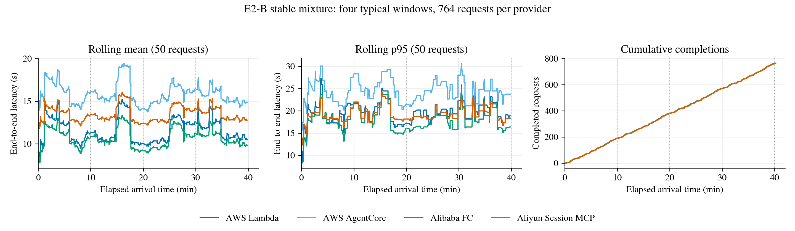
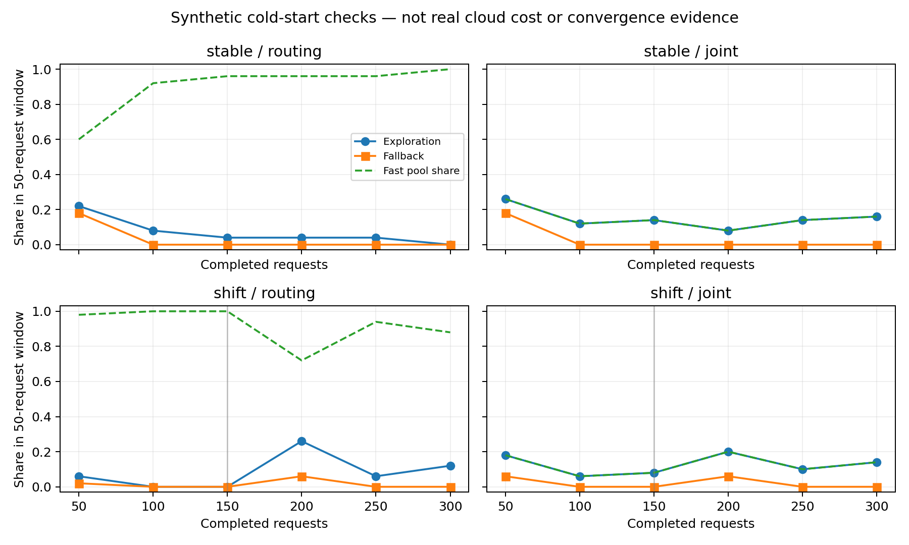

# Stage 8 — 真实任务集与冷启动机制验证

日期：2026-11-01。**本阶段尚未完成全部云端验收。** 已完成用户要求优先进行的 172 条候选审查、100 个不同 Prompt 的实际执行与独立验证，以及冷启动逻辑修复、本地到达序列执行、模拟机制检查和四个固定平台共 3,056 次真实正式执行。

## 四平台稳定组成实验结果

用户恢复实验后，已完成四个固定平台的真实云端运行：**每个平台 40 分钟、764 个请求，合计 3,056/3,056 成功，零失败、零丢弃**。每个平台覆盖 100 个原始 Prompt，使用相同的封存任务分配、输入和到达时序。四个 typical 窗口分别为 191 请求；同一个原始窗口重复拼接，段内不压缩时间，任务顺序按固定种子打乱。旧 1,444 请求版本没有启动正式运行。

| 平台 | 成功请求 | 平均延迟（秒） | p95（秒） | p99（秒） | 峰值 Harness 并发 |
|---|---:|---:|---:|---:|---:|
| AWS Lambda | 764/764 | 11.57 | 20.39 | 60.14 | 12 |
| AWS AgentCore | 764/764 | 15.86 | 24.66 | 54.52 | 15 |
| Aliyun FC | 764/764 | 10.68 | 18.13 | 44.01 | 11 |
| Aliyun Session MCP | 764/764 | 13.50 | 19.04 | 43.35 | 15 |

延迟为计划到达至完成的端到端时间，包含排队、Tool 执行、状态同步和原始 Capture 的 LLM 等待；模型决策复用，未产生新的 LLM API 调用。全部请求满足预设 120 秒 SLO。四个平台实际结束于到达窗口关闭后约 5.1–14.6 秒。每个平台执行 3,404 次真实 Tool 调用，最终结果通过 4,212 个原始独立测试用例，另有已捕获错误恢复过程中的验证调用；不把恢复中的预期失败算成最终请求失败。

Lambda 与 FC 配置 3,008 MB，FC 使用 2 vCPU，AgentCore 物理资源由平台管理。MCP 驻留状态、FaaS 每次恢复/保存状态、Session 绑定及资源隔离均通过逐请求核对。3,056 个 Session UID 全部不同，原始 Prompt 哈希、上游测试哈希和任务分配一致。



### 证据与复现入口

- 新封存序列：`results/stage8/e2-stable-4typical-v1`；云端输入：`results/stage8/cloud-stable-4typical-workload-v1`。
- 本轮结果目录：`results/stage8/cloud-stable-4typical-v1`。`formal-<provider>/<provider>` 包含逐请求 Trace、结果、Workload Profile、调度事件与 `window_report.json`。
- `build-v2/deployment.json` 保存四平台镜像审计和实际配置回读；`references.json` 为每平台 100 个任务的独立环境参考；`pilot-v2-<provider>` 均为 100/100 成功的严格 Replay。
- `execution-audit.json` 和 `audit_formal.py` 核对 3,056 个原始 Prompt 执行、独立测试、Session、状态生命周期和证据哈希；`sealed-source-files.tar.gz` 保存实际使用的工作区文件，包含已有用户改动；`formal-input-seal.json` 保存本轮配置哈希。
- `comparison/comparison.json` 使用原有配对比较工具生成；完整实际账单未获得，因此成本赢家为 null。PNG/PDF 与对应源文件哈希位于 `figure/stage8/stable-4typical`。

### 校验修复与费用边界

云端镜像内的 100 任务校准和新的严格 Pilot 均通过。此前校准/Pilot 中止记录完整保留，不计入正式的 3,056 请求。三个 Replay 问题已修复：`bcb61` 先验证图表时间注释属于真实调用区间，再只规范化该文字比较其他像素；`bcb823` 保留真实 sleep 耗时，通过独立记录的时间点复算返回均值和标准差；`bcb31` 对 Tool 输出与模型错误上下文使用同一规则，仅排除 NLTK 临时搜索目录，保留资源名称和错误类型。原始程序、输入、返回产物以及完整上游测试均未改写或跳过。规则和文件哈希见 `comparison-policy.json`。

全量 unittest：302 项，299 项通过、3 项因宿主机缺少数值依赖跳过；新增的两项动态结果测试在固定数值镜像中单独通过，另在四个平台完成了三个问题任务的全新 Session 严格回归。 事后 AgentCore 日志汇总改为按 Session 一次分组，避免大批量时重复解析整段日志；相关 34 项测试通过，新增检查验证 100 个 Session 的解析次数保持线性。该改动只影响日志收集，不改变云端执行。

**完整实际基础设施费用与成本收益仍为未知。** 首次查询时 AWS Cost Explorer 查询被拒绝（`User not enabled for cost explorer access`）；阿里云当日账单仍需获得 FC 明细并归属到正式窗口。平台用量日志与账单快照单独保留，缺失项不填零。 本次快照中，Lambda 匹配 3,396/3,404 次平台调用日志，AgentCore 匹配 3,404/3,404 次调用、751/764 个 Session 有 CPU/内存用量，两种 Aliyun 部署各匹配 3,404/3,404 次调用；这些是用量覆盖率，不是完整账单或 Session 尾部费用证明。预算账本保留校准、Pilot、中止尝试和正式运行的规划预留，预留不是实际支出。状态存储、镜像、日志、网络、Session 尾部驻留及控制开销尚未全部对账，不以执行时长乘价格冒充实际总费用。

本轮是四个固定平台基线，不是 Wabber 在线路由或收敛实验；单个种子、单次 40 分钟运行不能证明成本优势或统计显著性。云端部署和输入对象仍保留以便复核；Aliyun 最小实例数为 0，MCP Session 按既定空闲超时释放，未将后续存储费用记为零。

## 2026-11-03：正式请求归属与标准价重算

成本主口径已按用户要求改为 **真实计量用量 × 标准公开按量费率**，不扣账户免费额度、优惠券或资源包折扣。原始账单快照仅用于用量核对，不覆盖或冒充标准价结果。SKU 自带的临时盘容量仍按该服务的计价规则处理，不人为重复收费。

本次以原始请求/调用/Session 标识归集全部 3,056 个正式请求，代码入口为 `experiments.exp1.analysis.standard_cost`，费率文件为 `experiments/exp1/configs/stage8-standard-rates.json`。明细和补查记录在 `results/stage8/cloud-stable-4typical-v1/standard-cost-20261103-v1`；最新计算目录见同级 `standard-cost-latest.json`。

| 平台 | 正式阶段标准运行费（原币） | 折合人民币 | 归属程度 |
|---|---:|---:|---|
| AWS Lambda | $0.2720285066 | ¥1.80977361 | 3,404/3,404 次调用的 Billed Duration 均取得 |
| AWS AgentCore | $2.7802596386 | ¥18.49673988 | 764/764 个 Session 的返回计量流，包含窗口后用量 |
| Aliyun FC | ¥1.3096928866–¥1.3187310520 | 同左 | 混合计费小时的可靠界限，不是精确点值 |
| Aliyun Session MCP | ¥7.50288–¥23.16611 | 同左 | 混合计费小时无法精确拆分 |

**该表是运行费用，不是完整基础设施总成本。** 汇率采用实验前最近工作日 2026-10-30 的 ECB 参考值，1 USD = 6.6528822055 CNY，原始 XML 与哈希随结果保存；这不是银行结算汇率。

### 核对结果

- Lambda 使用 16,265.431 GB·秒、8,305.752 临时盘 GB·秒和 3,404 次请求，按 x86/us-east-1 标准费率重算；缺失的 9 条计费时长通过原生 Request ID 找到对应 REPORT 补齐，初始化不重复加价。
- AgentCore 使用 7.5162185622 vCPU·小时、223.0220187581 GB·小时。仅纳入正式 Session ID，重新分页读取 255,186 条属于这些 Session 的计量样本，查询范围覆盖可能的最大生命周期。没有用配置的 300 秒空闲超时乘内存来伪造实际用量。
- 两个平台的逐请求运行费求和与平台汇总严格相等。
- Aliyun FC 匹配 3,404 次正式调用；Session MCP 匹配 4,932 次正式平台调用，其中 1,528 次为初始化/协议调用。764 个 MCP 实例均独属于一个正式请求，实例创建与销毁记录齐全。
- 阿里云 `QueryUserOmsData` 的 Hour 数据与当天 CU 账单一致。15:00–16:00 UTC 可归属正式阶段；14:00–15:00 UTC 混有校准/Pilot。FC 利用单实例并发 1 下已确认的阻塞执行时长，收紧正式与非正式用量界限；不按调用次数或时间占比平摊小时 CU。
- Session MCP 的 HTTP 指标时长很短，不能替代后台执行和驻留计费时间；实例创建到销毁的物理时长也不能直接当作 CPU 活跃计费时长。它仍保留宽区间，不捏造精确数字。

### 尚无法完整归属的费用

对象存储历史容量/留存、全部存储 RPC（包括锁、HEAD、重试）、日志写入与保留、共享镜像层、完整公网出流量及控制宿主机资源均未取得足够的逐请求计量依据。所有未知项列入 `component-coverage.csv`，完整总成本和成本赢家保持 null。SDK 记录的状态/分支字节已经逐调用汇总，但不把字节数当成完整存储 API 账单次数。MCP 的分支字节是本地文件 I/O，不计成对象存储流量。

已核实用户新建的 `wabber-s3-audit`：记录状态桶对象的全部读写事件，日志桶为 `wabber-audit-879512791065-us-east-1`，日志完整性校验开启，SSE-S3 AES256 加密开启。实际开始时间为 **2026-11-03 03:30:46 UTC**，已成功投递。11 月 1 日实验期间没有可用 S3 对象访问日志，当前也没有其他 CloudTrail Lake 历史事件库；新增跟踪不能补录本轮历史。OSS 未配置访问日志目标。新审计可用于后续实验，其 11 月 3 日费用不混入本轮正式费用。

```sh
.venv/bin/python -m experiments.exp1.analysis.standard_cost \
  --evidence results/stage8/cloud-stable-4typical-v1/standard-cost-20261103-v1 \
  --output results/new-standard-cost-result
```

计算会拒绝覆盖旧结果，并校验原始 Trace 哈希、请求分配、平台记录完整性、费率地域/架构、Session 尾部查询范围、重复计量和费用求和。相关测试覆盖免费额度不参与计算、缺失数值拒绝、尾部计量、去重和混合小时上下界。未重跑云端负载，原始账单和执行证据保持独立。

## 真实数据与验收边界

独立清单位于 `benchmarks/DataSciBench/tasks/mix/manifest.json`。上游为 DataSciBench commit `84ef3d4d94d7362a5149cf14a73dc168fc4f2f33`，`metric/bcb_all_data.csv` SHA256 为 `be17d15d560815fd64e18dec6ccbac212a52e99c53f6c977acfd90bb05f70fc8`。161 个 BCB Prompt 全部与评测 CSV 逐字一致。

100 个验收 Prompt 均有真实 DeepSeek 决策、LangGraph 执行、预先准备的原始上游参数、实际 `task_func(*args)` 返回值、完整独立上游测试以及第二次真实计算的环境参考。没有用参考实现代替 Agent、用重复 Prompt 凑数、跳过失败测试或添加人工耗时。所含任务涵盖统计、表格处理、回归、分类、聚类、PCA、组合计算和可视化。BCB 输入是上游评测 fixture，不宣称是生产数据。

剩余 72 条的状态：50 条参考预检失败，9 条 Agent 验证失败，2 条引用未封存的绝对临时文件，5 条未适配，6 条沿用此前独立的六任务链路。本轮没有为单元素 tuple 与上游标量断言不一致的任务放宽检查。完整失败原因见 `tasks/mix/audit.json`。

`evidence.tar.gz` 保存 1,206 个文件，包括 100 条原始 Capture、100 条环境参考、106 个输入文件和 300 个实际执行产物。逐文件哈希检查通过。测试源不含在模型上下文中，运行镜像不包含参考实现，所有 pickle 都只在隔离环境反序列化。

## 时序与反馈

- E2-A：一个原始 typical 窗口，191 次到达，覆盖 100 个 Prompt。
- 初始 E2-B 稳定与变化组成：各 1 小时、1,444 次到达，均覆盖 100 个 Prompt；使用 typical、typical、high、high、low、low 六个窗口，明确标为拼接时序，没有压缩时间。当前稳定组成已按用户要求改为上述四个 typical 窗口。
- 任务分配、输入、随机种子、首次 Prompt 与首次语义族在到达前封存。变化组成只依据 Prompt/输入元数据产生的语义族分组。
- 本地真实执行了稳定序列的 30 秒前缀：4/4 成功，峰值并发 3，零丢失；平均提交延迟约 1.71 ms。Workload Model 新增 4 条样本，Provider Model 新增 4 条观测。
- 此本地执行为单个真实 local FaaS 环境，不当作 AWS/Aliyun 多 Provider 验证；未执行完整 1 小时真实实验。

实际记录位于 `results/stage8/local-arrivals`，可复现入口为 `experiments.exp1.runner.stage8_online local`。模型从空历史启动，未从封存 Capture 导入历史 profile；完成反馈来自实际执行。原有 MCP 驻留、FaaS 状态恢复/保存和 Session 绑定语义保留。

## 冷启动改动

`Exploration` 不再要求默认池和候选池同时具备完整预测。通过现有工具环境、内存、容量、超时和预算检查的池，在上下文证据不足时可以进行有限探测；未知成本/延迟与预测收益仍为 null。失败也消耗探测次数和预算，证据窗口允许后续重新探索。已知候选仍沿用原有成本/延迟比较与衰减探索。

`JointController` 可从实际回读容量构造探测计划，不再因缺乏可信价格计划而完全失去探测机会。容量费用先预留，实际准入仍等待容量回读，Session 不迁移。

日志将执行不可行原因与预测不足分开，并记录探索预算排除、策略未选中及禁用原因。完成反馈仍仅更新实际执行池；没有反事实反馈。

## 模拟机制检查，不是成本收益证明

复用原有 Tool 级模拟器及独立 train/validation 服务样本；清空 Workload/Provider 执行历史，分别运行稳定/变化组成和 routing/joint 策略，每组 300 次请求，共 1,200 次完成。

| 场景 | 策略 | 探索次数 | 首/末 50 次请求探索率 | 首/末回退率 |
|---|---|---:|---|---|
| 稳定 | routing | 21 | 22% / 0% | 18% / 0% |
| 稳定 | joint | 45 | 26% / 16% | 18% / 0% |
| 变化 | routing | 25 | 6% / 12% | 2% / 0% |
| 变化 | joint | 38 | 18% / 14% | 6% / 0% |

这些数据只证明机制能够从空历史探索、吸收反馈并改变策略，不证明所有策略收敛、不证明 100-Prompt 真实多云实验收敛，也不证明省钱。完整滚动成本、延迟分位数、预测覆盖/误差、路由比例与族/Provider 证据计数保存在 `results/stage8/cold-online-smoke-v2`。



成本汇总将真实执行费用、合成用量、预算上限分别记录，缺少完整基础设施费用时总成本与收益保持 null。原有七类策略继续可配置；最佳固定 Provider 的成本比较只有在四个固定部署均有完整、同口径、同环境/工作负载/先验的报告时才产生结果。

## 验证与尚未完成的工作

此前本地阶段全量 unittest：294 项，全部通过，1 项因当前宿主机缺少相关数值依赖跳过；真实数值计算在固定 Docker 环境中完成。并发批跑期间两项旧测试曾超时，降低负载后单独复测及最终全量检查均通过。增加了冷启动无历史、无默认池、预算/环境/容量约束、单池因果反馈、无价格计划容量租约、封存门槛、时序精度、实际费用缺失、失败语义比较和临时文件扫描竞争的测试。

独立 Dockerfile 从固定官方 Python 镜像和完整依赖锁重新构建成功；在新镜像上对图表任务 bcb1011 的严格 Replay 通过，未使用宽松校准模式。图表像素和数值变化的负向检查也通过。

仍须完成：

1. 基于本轮真实四平台证据完善性能/容量模型，保留尚未测得的费用与资源指标。
2. 执行 E2-A 和主动路由、探索、联合容量控制策略的真实长期实验，验证在线反馈与收敛；本轮固定基线不替代这些验收。
3. 补齐完整可归属费用；AWS 账单现已可读，运行用量的标准价重算已完成，存储、日志、网络及控制等费用仍有归属缺口。
4. 完成剩余路由策略的长期实际运行，核对计算、存储、保留、扩缩容和控制费用，再报告最佳固定 Provider 对照与可能回本点。

本轮已完成四平台云端部署、100 任务环境校准、完整 Pilot 和 3,056 次正式固定平台执行。基础设施实际总费用与收益未知，完整在线路由与收敛验收仍未完成。

## 2026-11-03：使用真实 E2-B 记录验证当前 Stage 8 路由

**结论：冷启动探索生效，反馈能进入模型；当前版本仍没有从探索/回退转入正常成本路由，不能据此宣称在线收敛或节省成本。** 本轮保留路由实现不变，只增加离线验证入口和因果性测试。

结果目录：`results/stage8/route-validation-20261103-v1`。`summary.json` 保存四组策略、四个固定平台基线及分窗口统计；各 `*-requests.json` 保存逐请求选择、预测覆盖、缺失特征、可见反馈数和反馈时间；`sources.json`、`config.json`、`seal.json` 保存代码、数据及参数哈希。原实验的 12,224 个证据文件哈希全部复核通过，四个平台的 100 请求 Pilot 均通过。

### 回放方法与边界

- 使用同一封存的 764 次到达、100 个 Prompt、4 × 10 分钟 typical 序列。四个平台的 3,056 条真实记录逐一按到达 ID、Prompt 哈希和输入清单配对。
- 调用当前工作目录的 `OnlineRouter`、`WorkloadModel`、`ProviderModel`。模型从空历史开始；Pilot 只证明执行环境可用，不导入目标任务的性能结果。
- 当前请求的路由输入只有原始 Prompt 和输入文件元数据生成的 Descriptor、到达前反馈及过去 60 秒到达率。路由请求 ID 使用中性的序号；不传 `task_id`，不读取当前执行 DAG 或 PLAN 结果。
- **先选择平台，再读取其对应结果；到该请求记录的执行时长结束后才更新模型，完成时刻与下一次到达相同的反馈也不可见。** 另外三个平台的结果不作为反馈。回放只重设反馈时钟和根请求身份，不改写计算时长或状态访问数据。
- 使用标准价预测和冻结的 ECB 汇率，不考虑账户免费额度。Aliyun CPU/内存/请求单价更新为 0.00011 元/CU，10 GiB 附带临时磁盘按产品费率处理。预测沿用现有模型声明的 Session 尾部、状态及控制开销假设，不能当作完整实际账单。
- 默认探索参数为 epsilon=0.1、min_samples=3、证据窗口 3600 秒。成本权重 1、延迟权重 0.001 CNY/秒；每请求保守预留 1 CNY，总预算 1000 CNY，探索预算 300 CNY。未将事后到账的 Session 尾部计量提前反馈给模型，也未将预算预留报告成实际支出。
- 准入上限 32 是与原 Harness 一致的回放场景，不是假定平台物理容量。实际记录全部在 120 秒内完成。本轮不修改容量，也不测量 JointController 扩缩容收益。

这是**基于真实测量的固定结果因果回放**：选中某平台后复用它在固定平台实验中的对应时长。实际混合路由会改变平台负载、冷启动和排队，回放不识别这些影响，也不是新增在线云端实验。四个窗口来自同一个 typical 时序的重复，不能视为四次独立云端重复试验。

### 实际结果

每组均回放完成 764 次请求，没有准入拒绝。下表“正常利用”只计 `cost_latency_objective`，不把默认回退算成利用。

| 策略 | 默认池 | 非默认探索 | 默认回退 | 正常利用 | 回放平均延迟 |
|---|---|---:|---:|---:|---:|
| 关闭主动探索 | Lambda | 0 | 764（100%） | 0 | 11.574 秒 |
| Stage 8，seed=8 | Lambda | 45 | 719（94.11%） | 0 | 11.648 秒 |
| Stage 8，seed=18 | Lambda | 36 | 728（95.29%） | 0 | 11.675 秒 |
| Stage 8，seed=8 | FC | 42 | 722（94.50%） | 0 | 10.858 秒 |

主实验 seed=8 的选择为 Lambda 719、AgentCore 19、FC 14、Session MCP 12；反馈数量与各平台选择数量逐项一致。首次非默认探测发生在第 2 个请求（10 秒），选中当时零样本的 AgentCore；45 次探索中 25 次是有界冷启动，20 次来自不确定的解析式机会。100 个首次出现的 Prompt 有 12 次非默认探索；664 次重复 Prompt 有 33 次。35 个首次请求族中有 4 次在首次到达即探索，未要求所有新族遍历全部平台。

| 主实验窗口 | 探索次数/比例 | 默认回退比例 | 正常利用 | 延迟预测 MAE（有预测的请求） |
|---|---:|---:|---:|---:|
| 0–10 分钟 | 17 / 8.90% | 91.10% | 0 | 3.044 秒 |
| 10–20 分钟 | 9 / 4.71% | 95.29% | 0 | 2.781 秒 |
| 20–30 分钟 | 11 / 5.76% | 94.24% | 0 | 2.853 秒 |
| 30–40 分钟 | 8 / 4.19% | 95.81% | 0 | 2.635 秒 |

预测误差并非单调下降，探索减少也没有转成利用。改默认池后大部分流量跟随新默认池，说明当前的稳定分布主要来自回退规则，不能解释为学到了最优平台。固定 FC 的实测平均延迟为 10.677 秒；没有用事后最快平台逐请求选优作为可部署策略。

### 阻碍收敛的具体原因

1. `atsuite/provider_model/model.py` 的置信度要求邻居特征基本完整；只豁免了 `instances`。这批四个平台各 764 条记录的**请求级** `tool_cpu_s` 全部缺失，因此持续被标为低置信度。更正：这不是原始 CPU 测量全部缺失；后续独立核查确认每个平台 2,640 次 Tool 调用已有 worker CPU，缺少 764 次 prepare 计数导致请求汇总为空。即使 Lambda/FC 已有可用的运行时长和解析成本，旧版 `OnlineRouter` 的 `reliable` 条件仍不成立。主实验末窗口 191 次选中候选全部带有 `provider_history_insufficient`，其中 141 次虽有成本预测仍默认回退。日志名称也不能准确区分“样本不足”和“指标永久缺测”。
2. 各平台另有 48 条记录缺少完整逻辑状态指标；一个预测混合中含这类样本，就可能使成本预测不完整。主实验成本预测覆盖率只有 65.18%。不能把未观测状态用量填成零来提高覆盖。
3. AgentCore 没有可确认的 CPU/内存配置值，同时缺少 Tool CPU 观测，现有解析模型无法建立完整成本预测。事后到账的实际运行计量可做离线评分，不能伪装成请求完成时已知的在线特征。
4. 探索计数、模型更新本身有效，但缺测导致的利用门槛不会随样本增加自动消失。仅扩大实验规模或降低探索率不能解决这个问题。

后续应按预测目标和平台区分必需测量与可选特征；对完整 Workflow 中未发生的计数和真正缺测的计数作区别；保留不可识别资源与成本的不确定性，再用同一封存数据复测。此次验证没有为了改善结果放宽这些条件，也没有修改路由器。

### 标准价费用与验证范围

`runtime-cost-coverage.json` 只在全部决策结束后，从此前可归属用量账本按选中的请求取运行标准成本。主实验已知 AWS 运行成本小计为 **2.152707 元**，另有 **26 条 Aliyun 请求**不能精确归属单请求费用；固定 Lambda 的完整运行标准成本为 **1.809774 元**。所以在固定结果回放假设下，主实验连已知运行费用小计都高于固定 Lambda，不能宣称运行成本节约。此比较不覆盖完整基础设施总成本，也不代表真实混合路由的新账单。

Aliyun 的原固定窗口费用仍使用已验证上下界，没有按请求数摊分小时费用、取区间中点或应用免费额度。完整基础设施费用、净收益、最佳总成本策略与动态容量收益保持未知。

新增测试覆盖同刻反馈不可见、只获取选中平台的结果、只更新选中平台、未来结果变化不影响此前决策、任务 ID 不进入路由及预留费用不冒充实际费用。连同 Stage 8、路由、Stage 7 和联合控制相关测试，共 **66 项通过**。

复现回放（约十分钟本地计算，无云端请求，输出目录必须不存在）：

```sh
.venv/bin/python -m experiments.exp1.runner.stage8_empirical \
  --output results/stage8/new-route-validation
```

本次费用评分脚本为 `results/stage8/route-validation-20261103-v1/score_runtime.py`，其源码与账本哈希记录在评分结果中。所有本轮路由结果均为离线验证；真实在线 E2-A/E2-B、变化组成适应性和联合容量控制仍需另行验证。

## 2026-11-03：资源观测与目标置信度修复后的验证

**已解除“请求 CPU 汇总缺失导致永久不能利用预测”的阻塞；尚未证明最优平台收敛、降低延迟或节约总成本。** 派生结果单独位于 `results/stage8/resource-confidence-20261103-v1`，未启动新的收费云端执行。

### 独立核实和计量语义

重新读取并校验了四个平台原始 Trace 的哈希。每个平台都是 3,404 次 Tool：prepare_workspace 764 次无 CPU 计数；execute_analysis 896、merge_artifacts 848、validate_result 896 次均有 worker 进程 CPU 计数。按调用数计算的原始计数覆盖率为 **77.56%**，不是“CPU 工作量覆盖了 77.56%”。

| 平台 | 已测 worker CPU 小计（秒） | 完整请求/平台 CPU 总量 |
|---|---:|---|
| Lambda | 3381.387654 | 未知 |
| AgentCore | 5482.650902 | 未知 |
| FC | 3058.696819 | 未知 |
| Session MCP | 2845.291750 | 未知 |

`raw-cpu-audit.json` 保存调用计数与原始资源字段例子。小计保持原始计量范围，没有填补 prepare、以墙钟推算 CPU 或充当账单 CPU。

本轮修改：

- `atsuite_sdk/resources.py` 在 `UnifiedAgentTool.execute_from_dict` 统一入口自动采集调用线程 CPU 增量，包括该线程执行的恢复/保存开销。FaaS/MCP 服务端通过现有 Provider Adapter 元数据通道透传，业务 Tool 不需增加采集逻辑。调用结束或失败都会记录；同一线程嵌套 Tool 的重叠计数被扣除，跨线程继承的上下文不会错误相减，无法识别的范围保留未知。
- Runtime 线程计数排除其他线程和子进程。隔离 worker 复用已有 `RUSAGE_SELF` 前后差值，显式标记为 worker 进程内所有线程、排除子进程的调用增量；MCP 常驻 worker 不报告累计进程 CPU。不会叠加 `RUSAGE_CHILDREN`、Runtime 线程与 worker 计数以冒充完整 Tool 总量。计时范围依据 [Python thread_time 文档](https://docs.python.org/3/library/time.html#time.thread_time) 和 [Linux getrusage 文档](https://man7.org/linux/man-pages/man2/getrusage.2.html)。
- Tracing 分别保留 Runtime 与 worker 的来源和范围；请求画像新增 `tool_cpu_measured_s`、`tool_cpu_coverage`、`cpu_observation`。小计每个调用只选择一个计数来源，完整 `tool_cpu_s` 仅在全部 Tool 明确提供完整调用范围计数时成立。旧 Trace 的完整总量仍为 null；有计数但范围不全也不会变成完整总量。
- 采集不改变 Tool 返回值、隔离策略、Session 绑定或访问锁。MCP 状态继续驻留，FaaS 继续按调用恢复/保存。新 Runtime 尚未部署到云端，本次回放使用的是旧 Trace 中已有的观测。

### 模型与诊断变更

Provider Model 分别输出 `confidence.latency` 和 `confidence.cost`，Router 要求二者均可信且 Workload 匹配成立，才进入正常成本/延迟选择。保留原有最小样本数、必需特征完整性、已观测取值范围及校准检查。

- 延迟依赖历史实际延迟、工具/LLM 时长、并发结构与到达率。缺失实际 CPU 不再统一判失败。
- Lambda/FC 使用配置分配量和时长计价时，实际 CPU 是可选特征；必要的配置、计时、状态及成本证据仍须满足现有解析模型要求。
- 按实际 CPU 计价的 AgentCore 继续要求完整 CPU 证据及必要资源信息；不能用 worker 小计或请求 CPU 覆盖率替代。其成本仍不可信，不进入正常成本利用。
- 完整历史 Workflow 中未发生的事件计数视为结构性零；不完整记录的缺失计数保持未知。这不使用当前请求完成后的 DAG。
- 未校准的解析延迟不再覆盖真实历史延迟；没有可靠历史时保留未知。因此部分预测覆盖率下降，不能只挑改善的指标报告。
- 诊断区分 `sample_insufficient`、`metric_missing`、`distribution_outside_support`、`cost_evidence_insufficient`、`latency_evidence_insufficient`，并列出必需缺测、可选缺测和分布外字段。容量、环境、预算及截止时间等执行不可行原因仍独立存放。

### 相同封存数据、相同参数的前后对照

修改前复用上一轮已封存结果，并逐文件确认本轮修改前的路由/模型源码哈希与该基线一致。修改后使用相同 100 Prompt、764 次到达、种子、默认池、价格、权重、预算和容量场景；`compare.py` 检查两轮配置完全一致。只向选中的平台反馈，完成时间与到达同刻仍不可见；历史数据、Prompt、独立正确性要求都未改变。

| 配置 | 探索率：前 → 后 | 默认回退率：前 → 后 | 正常利用：前 → 后 | 修改后选择数（Lambda / AgentCore / FC / MCP） |
|---|---|---|---|---|
| 无探索，默认 Lambda | 0% → 0% | 100% → 53.27% | 0 → 357（46.73%） | 764 / 0 / 0 / 0 |
| 探索 seed=8，默认 Lambda | 5.89% → 5.89% | 94.11% → 52.23% | 0 → 320（41.88%） | 712 / 19 / 19 / 14 |
| 探索 seed=18，默认 Lambda | 4.71% → 4.71% | 95.29% → 54.45% | 0 → 312（40.84%） | 728 / 14 / 7 / 15 |
| 探索 seed=8，默认 FC | 5.50% → 5.37% | 94.50% → 53.01% | 0 → 318（41.62%） | 11 / 19 / 723 / 11 |

每组完成 764 次，没有准入拒绝，反馈数等于各平台选择数。主实验 320 次正常利用中，313 次为 Lambda、6 次 FC、1 次 Session MCP；AgentCore 没有被伪造为成本可信。其他默认池/种子对照仍有强默认池依赖，不能把正常利用比例提高解释成已找到最佳平台。

| 主实验窗口 | 探索率（前/后相同） | 回退率：前 → 后 | 正常利用率：前 → 后 | 延迟 MAE：前 → 后 |
|---|---:|---|---|---|
| 0–10 分钟 | 8.90% | 91.10% → 70.16% | 0% → 20.94% | 3.044 → 2.988 秒 |
| 10–20 分钟 | 4.71% | 95.29% → 62.83% | 0% → 32.46% | 2.781 → 2.774 秒 |
| 20–30 分钟 | 5.76% | 94.24% → 43.46% | 0% → 50.79% | 2.853 → 2.893 秒 |
| 30–40 分钟 | 4.19% | 95.81% → 32.46% | 0% → 63.35% | 2.635 → 2.599 秒 |


主实验首次 Prompt 与重复 Prompt 分开统计：

| 请求组 | 数量 | 探索：前 → 后 | 回退：前 → 后 | 正常利用：前 → 后 | 修改后延迟/成本预测覆盖 |
|---|---:|---:|---:|---:|---|
| 首次 Prompt | 100 | 12 → 12 | 88 → 69 | 0 → 19 | 85.00% / 63.00% |
| 重复 Prompt | 664 | 33 → 33 | 631 → 330 | 0 → 301 | 97.59% / 65.81% |

正常利用首次 Prompt 的证据来自已完成的相近请求，不按任务 ID 查表。35 个首次请求族仍为 4 次探索、31 次回退，没有强行宣称未知族可直接利用。

| 配置 | 延迟预测覆盖：前 → 后 | 成本预测覆盖：前 → 后 | 延迟 MAE：前 → 后 |
|---|---|---|---|
| 无探索 | 99.35% → 99.35% | 69.50% → 69.50% | 2.796 → 2.792 秒 |
| seed=8 | 98.17% → 95.94% | 65.18% → 65.45% | 2.826 → 2.810 秒 |
| seed=18 | 98.04% → 95.68% | 65.58% → 65.58% | 2.919 → 2.892 秒 |
| 默认 FC | 97.51% → 95.29% | 66.10% → 66.10% | 2.453 → 2.399 秒 |

MAE 仅在有预测的请求上计算。覆盖下降主要因为不再使用未校准解析延迟覆盖未知量；不能将不同覆盖集上的小幅误差下降当作显著性能改进。主实验回放平均延迟为 11.648 → 11.651 秒，基本不变。成本预测包含基础设施模型假设，而准确单请求账本只覆盖部分运行费用，故未混用不同口径计算成本 MAE，该项保持未知。

### 标准价费用覆盖与数据缺口

所有费用沿用标准价，无账户免费额度。以下只是在决策结束后，对选中请求已有运行计量取小计；不提前反馈尾部账单，不使用预算预留作为费用，也不摊分 Aliyun 混合小时费用。

| 修改后配置 | 已知运行标准成本小计（CNY） | 无单请求精确费用的 Aliyun 请求 | 完整路由运行费用/基础设施费用 |
|---|---:|---:|---|
| 无探索 | 1.809774 | 0 | 运行 1.809774；基础设施未知 |
| seed=8 | 2.141404 | 33 | 未知 / 未知 |
| seed=18 | 2.061532 | 22 | 未知 / 未知 |
| 默认 FC | 0.481591 | 734 | 未知 / 未知 |

主实验已知小计比修改前 2.152707 元低，但未知 Aliyun 请求也从 26 增至 33，**不能把小计差值当作成本节约**。其已知运行费用仍高于固定 Lambda 的完整运行费用。Aliyun 原固定窗口上下界不变；未取中点、按请求数分摊或宣称完整总成本收益。

剩余缺口包括：prepare 的历史 CPU；worker 范围以外的线程/子进程与平台开销；AgentCore 实际计费资源及尾部证据的在线可得性；各平台 48 条请求的逻辑状态指标；部分族/平台有效样本与分布覆盖；单请求 Aliyun 用量及存储、日志、网络、控制等完整归属。新增采集不能补造旧 Trace。

### 测试、复现与后续采集

新增回归测试覆盖：未修改业务 Tool 的自动采集、真实本地 FaaS/MCP 元数据传输与状态连续性、失败调用、并发线程归属、MCP 调用增量、嵌套调用去重、跨线程上下文继承、采集不可用、worker/Runtime 不叠加、部分小计与完整总量区分、Lambda/FC 缺 CPU 仍可利用、AgentCore 成本仍不确定、样本不足/必需指标缺测/分布外拒绝、结构性零与缺测区别、未校准成本不替代实测延迟。原有反馈因果性与预算/隔离测试保留。

最终全套测试 **319 项：316 通过，3 项因宿主机数值依赖缺失跳过**。另在本地已有 FC 镜像中，断网、只读挂载工作区执行了 7 项数值/驻留与恢复集成测试，全部通过，覆盖宿主机跳过项及新增 worker 计量范围断言。没有拉取镜像、部署云端或发起收费请求。测试记录保存在派生目录中。

```sh
PYTHONPATH=tests:. .venv/bin/python -m unittest discover -s tests
.venv/bin/python -m experiments.exp1.runner.stage8_empirical \
  --output results/stage8/new-confidence-replay
.venv/bin/python results/stage8/resource-confidence-20261103-v1/compare.py
```

生产模型代码、输入、逐请求结果、配置与费用覆盖分别封存。比较脚本默认复核本次固定的 before/after 目录，生成 `comparison.json`、PNG 和 PDF；新回放可单独检查其 `summary.json`。

如要确认新 Runtime 在四个真实平台上的观测与账单归属，建议后续小规模采集，**当前只准备方案，未获批、未执行**：

- 6 个原始已验证 Prompt：bcb1011、bcb1035、bcb1089、bcb409、bcb845、bcb871；各重复 2 次、四个平台共 **48 请求**。先串行，再以并发 2 验证归属；请求超时 120 秒，沿用独立正确性检查和封存 LLM 重放，无新 LLM 调用。
- 审批预算预留 **20 CNY**：运行 5、状态与日志 5、镜像/部署 5、余量 5。它是预算申请，非估算账单，未按旧 Aliyun 请求数分摊。保守已计加已预留达到 10 元即停止新请求，剩余预算覆盖尾部与延迟费用；账单延迟意味着这不是云平台扣款硬上限。
- 放行前检查新镜像源码、实际资源配置、Session 生命周期、S3/OSS 访问日志及独立费用边界。AgentCore 资源/费用上界未核定时不放行该平台；记录实际日志可用时间，不能将尾部计量提前用于路由。采集后排空、清理仅本次创建的资源并核验。

具体任务、输入哈希、时序和预算在 `proposed-pilot.json`，须用户另行审批后才能部署或运行。该 Pilot 只验证资源观测与费用归属，仍不能替代真实混合路由、负载变化、联合扩缩容或完整基础设施收益实验。
